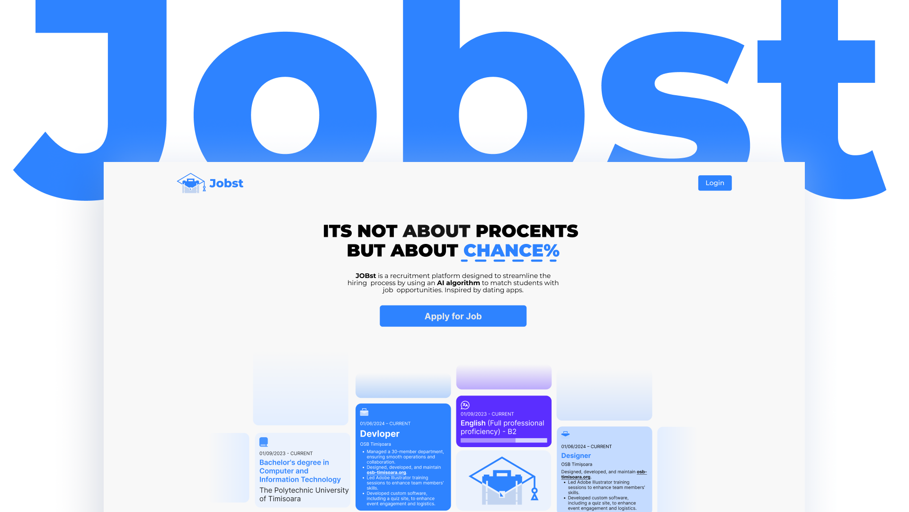
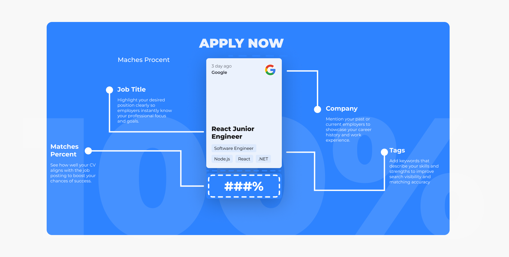

## Jobst
Jobst is a modern recruitment platform designed to eliminate the friction in the hiring process. By utilizing an AI-driven matching algorithm, Jobst connects students with job opportunities through an intuitive interface inspired by dating apps.

## Key Features
1. AI-Powered Matching: Intelligent algorithms that match candidate skills and preferences with company requirements.
2. Dating-App Mechanics: A streamlined "swipe-style" or match-based experience for exploring job opportunities.
3. Student-Centric: Specifically tailored for university students looking for internships and entry-level roles.
4. RESTful Architecture: High-performance communication between the frontend and backend.
5. Entity Framework Integration: Robust data management and full CRUD operations.

## Tech Stack
### Frontend
- **Framework**: React with TypeScript (77.2% of the codebase)
- **Styling**: SCSS (Sass) for modular and maintainable design.
**API Communication**: Axios for efficient RESTful requests.
### Backend
- **Framework**: .NET (C#)
- **Database**: SQL Server / MySQL via Entity Framework Core.
- **Containerization**: Support for Docker-based deployment.

## Repository Structure
```
Jobst/
├── assets/           # visula Resurses for Documentation
├── client/           # React + TypeScript frontend application
├── server/           # .NET Backend API & Logic
```
## Getting Started
### Prerequisites
- Node.js (v16+)
- .NET SDK (v6.0 or higher)
- SQL Server
### Installation
Clone the repository:
```Bash
git clone https://github.com/TandRAF/Jobst.git
cd Jobst
```
Setup the Backend:
```Bash
cd server
dotnet restore
dotnet run
```
Setup the Frontend:
```Bash
cd ../client
npm install
npm start
```